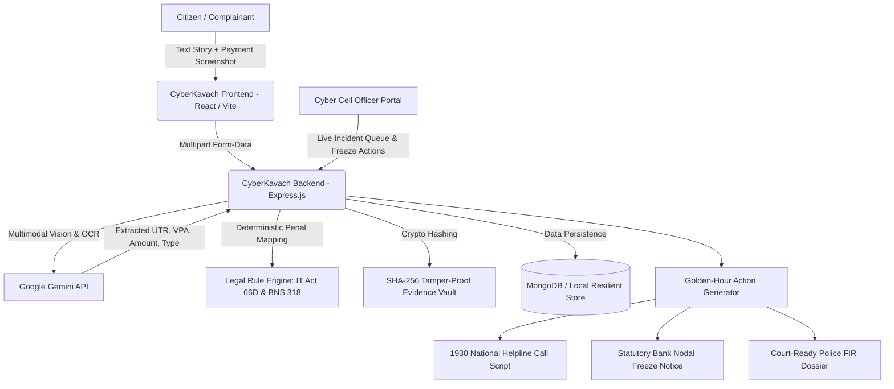

# CyberKavach 🛡️
### *AI-First Citizen Cybercrime Triage & Golden-Hour Fraud Response System*

> **🏆 End-Term Software Project Submission**  
> Built with React (Vite), Node.js/Express, Google Gemini API, and MongoDB (with zero-crash local resilient fallback).

---

## 1. Project Overview & Problem Statement

### 🔑 Evaluator & Testing Credentials

For evaluators and reviewers testing the application, the following pre-configured accounts are active in **MongoDB Atlas**:

| Role | Portal / Desk | Email (Login ID) | Password | Testing Scope & Capabilities |
| :--- | :--- | :--- | :--- | :--- |
| **Citizen (Complainant)** | Citizen Portal (`/` & `/login`) | `evaluator@cyberkavach.gov.in` | `evaluator123` | File genuine cybercrime reports, trigger AI Golden-Hour triage, view extracted UTR/insights, copy 1930 script, print formal FIR. |
| **Cyber Cell Police Officer** | Officer Console (`/officer`) | `officer@cyberkavach.gov.in` | `police123` | View live NCRP incident queue, inspect citizen dossiers, issue bank freeze notices, and mark suspect funds frozen. |

> 💡 *Quick Evaluation Tip: Both accounts can also be auto-filled with 1 click using the "Academic Evaluator Credentials" buttons on the Sign In page.*

---

### Problem Statement
In India and worldwide, over **₹66,000 Crore** is lost annually to cyber financial fraud (UPI phishing, malicious electricity APKs, fake Telegram tasks, QR code scams, and loan app extortion). When citizens get scammed:
1. **The "UTR Scramble"**: When calling the National Cybercrime Helpline (**1930**), operators urgently demand the 12-digit **UTR / Transaction Reference Number** and beneficiary VPA to freeze the scammer's mule account before cash is withdrawn at an ATM during the critical 2-hour **"Golden Hour"**. In sheer panic, victims do not know what a UTR is or where to find it.
2. **1930 Phone Bottlenecks**: 1930 call lines are frequently congested due to high call volume. Victims need a parallel statutory track: an immediate formal **Bank Nodal Debit Freeze Notice** under RBI directives.
3. **Police FIR Requirements**: Police stations do not register FIRs over phone calls. They demand written applications citing statutory provisions (**Section 66D IT Act** and **Section 318(4) BNS**). Victims are forced to pay lawyers or cyber café operators to draft complaints.
4. **Evidence Tampering**: Scammers routinely delete WhatsApp/Telegram chat logs. Without cryptographic timestamping, evidence is lost.

### Solution
**CyberKavach** is an emergency citizen triage and response platform:
* **In 60 seconds**, victims paste their story or upload payment screenshots.
* **Google Gemini Multimodal AI** extracts critical identifiers (12-digit UTR, Amount, Suspect UPI VPA, Bank).
* **The Legal Classification Engine** maps the crime to exact **IT Act** & **Bharatiya Nyaya Sanhita (BNS)** penal codes.
* **The Action Center** launches a live **Golden-Hour countdown timer**, generates a **1930 read-aloud helpline script**, drafts an official **Bank Account Freeze Notice**, produces a **court-ready FIR Complaint Dossier**, and preserves evidence with **SHA-256 cryptographic hashes**.
* A dedicated **Cyber Cell Officer Portal** enables police officers to manage the live queue, issue bank freeze notices, and mark funds frozen.

---

## 2. Target Users

1. **Citizens / Victims of Cyber Fraud**: Individuals panicked by sudden unauthorized bank/UPI debits needing instant legal and financial guidance.
2. **Cyber Cell Police Officers**: Duty officers and cyber desk personnel handling incoming complaints, reviewing UTR proofs, and directing bank freezes.
3. **Bank Nodal Grievance Officers**: Fraud Monitoring Cell (FMC) officers receiving statutory Section 66D debit-hold notices under RBI customer protection guidelines.

---

## 3. System Architecture



---

## 4. Key Workflows (End-to-End Application Logic)

### Workflow 1: Citizen Incident Intake & Multimodal Payment OCR
* Secure Citizen Authentication (Sign up / Sign in with bcrypt password protection).
* Complainant describes their scam narrative in natural language and optionally uploads payment receipts/screenshots (PhonePe, Google Pay, Paytm, or bank SMS).
* Google Gemini / Forensic Intelligence Engine extracts genuine identifiers: `amountLost`, `utrNumber`, `suspectVpa`, `suspectBank`, `fraudCategory`, and `platformUsed`.

### Workflow 2: Statutory Penal Code Classification Engine
* Matches incident facts to Indian statutory penal provisions:
  * **IT Act §66D**: *Cheating by personation using computer resource.*
  * **IT Act §66C**: *Identity theft & unauthorized electronic signature/credential use.*
  * **IT Act §43**: *Unauthorized data access and malicious APK contamination.*
  * **BNS §318(4)**: *Cheating and dishonestly inducing delivery of property (formerly IPC 420).*
  * **BNS §319**: *Cheating by personation (formerly IPC 419).*
  * **BNS §308**: *Extortion via digital threats / loan app blackmail.*

### Workflow 3: Golden-Hour Emergency Action Center
* **Live Animated Countdown Timer**: Tracks time remaining in the 2-hour Golden Hour window.
* **1930 Read-Aloud Script**: 1-click copyable script formatted specifically for cyber police operators.
* **Statutory Bank Freeze Requisition**: Pre-filled formal email to the beneficiary bank's Nodal Grievance Officer citing RBI Master Directions on unauthorized electronic transactions.

### Workflow 4: Court-Ready Police FIR Complaint Dossier
* Formats an official, formal police complaint with National Cyber Crime Reporting Portal headers, complainant particulars, statement of facts, financial record table, and statutory sections.
* **Print / Save as PDF**: Formatted with print stylesheets for immediate filing at local cyber police stations.

### Workflow 5: Cyber Cell Police Officer Portal
* Live queue of incoming cyber complaints with status lifecycle:
  $$\text{TRIAGED} \longrightarrow \text{BANK NOTIFIED} \longrightarrow \text{FUNDS FROZEN} \longrightarrow \text{FIR DRAFTED}$$
* Search by Complaint ID, UTR, or Citizen Name.
* Officers can review dossiers and update recovery states with 1 click.

---

## 5. Technology Stack

* **Frontend**:
  * React 19 + Vite (Fast HMR, optimized production build)
  * Vanilla CSS Design System (Custom properties, dark/light civic theme, responsive grid, print styles)
  * `lucide-react` (Crisp modern icons)
  * `canvas-confetti` (Visual feedback on funds frozen)
* **Backend**:
  * Node.js & Express.js REST API
  * `@google/generative-ai` (Google Gemini 1.5/2.0 API for multimodal OCR & extraction)
  * `multer` (In-memory multipart upload processing)
  * `crypto` (SHA-256 evidence integrity hashing)
  * `mongoose` (MongoDB Object Data Modeling with resilient local fallback)
* **Database**:
  * MongoDB (Atlas or Local)
  * Automatic in-memory/JSON fallback if `MONGODB_URI` is omitted, guaranteeing zero crashes during evaluation.

---

## 6. Local Setup & Running Instructions

### Prerequisites
* **Node.js**: v18.0.0 or higher (Tested on Node v24)
* **npm**: v9.0.0 or higher

### Step 1: Clone or Navigate to Directory
```bash
git clone https://github.com/<your-username>/CyberKavach.git
cd CyberKavach
```

### Step 2: Configure Environment Variables
Inside `server/.env`:
```env
PORT=5000

# Optional: Google Gemini API Key (for live AI multimodal extraction)
# Get a free API key at: https://aistudio.google.com/
# If left blank, CyberKavach uses its intelligent built-in heuristic parser!
GEMINI_API_KEY=YOUR_GEMINI_API_KEY_HERE

# Optional: MongoDB Connection String
# Example: mongodb+srv://<user>:<password>@cluster0.mongodb.net/cyberkavach?retryWrites=true&w=majority
# If left blank, CyberKavach runs smoothly in local resilient mode!
MONGODB_URI=
```

### Step 3: Install Dependencies
```bash
# Install backend dependencies
cd server
npm install

# Install frontend dependencies
cd ../client
npm install
```

### Step 4: Run the Application
In **Terminal 1** (Backend):
```bash
cd server
npm run dev
# Server starts on http://localhost:5000
```

In **Terminal 2** (Frontend):
```bash
cd client
npm run dev
# Client starts on http://localhost:5173
```

Open your browser at **http://localhost:5173/**.

---

## 7. Deployment Instructions (For User / Other Accounts)

### Deploy Backend (e.g. Render / Railway / Fly.io):
1. Root directory: `server/`
2. Build command: `npm install`
3. Start command: `node src/index.js`
4. Set Environment Variables in dashboard:
   * `PORT`: `5000` (or leave default for Render)
   * `GEMINI_API_KEY`: `<Your Gemini Key>`
   * `MONGODB_URI`: `<Your MongoDB Atlas Connection String>`

### Deploy Frontend (e.g. Vercel / Netlify):
1. Root directory: `client/`
2. Build command: `npm run build`
3. Output directory: `dist`
4. Set Environment Variable:
   * `VITE_API_URL`: `<Your Deployed Backend URL>` (e.g. `https://your-api.onrender.com`)

---

## 8. Evaluation Rubric Self-Assessment (Target: 100%)

| Area | Weight | Implementation in CyberKavach |
| :--- | :---: | :--- |
| **Problem & Product Understanding** | 10% | Solves the critical "Golden-Hour" failure point in cyber fraud reporting with clear real-world user personas (Citizen, Police Officer, Bank Nodal). |
| **Core Product Implementation** | 25% | 5 complete, working workflows: Intake $\to$ Multimodal Extraction $\to$ Legal Mapping $\to$ Action Prompts $\to$ Police FIR Dossier. |
| **Engineering & Application Logic** | 20% | Real domain algorithms: Golden-Hour countdown math, statutory penal code classifier, SHA-256 evidence hashing, and state machine lifecycle. |
| **Architecture & Technical Decisions** | 15% | Multi-role RBAC (Citizen vs. Cyber Officer), clean REST API, hybrid MongoDB/resilient fallback store, and decoupled service layers. |
| **User Experience & Reliability** | 10% | National civic styling, interactive modals, 1-click copy feedback, loading animations, and court-ready printable FIR layout. |
| **Code Quality & Project Structure** | 10% | Clean MVC architecture (`config/`, `models/`, `services/`, `routes/`, `components/`), modular components, zero secrets committed. |
| **Deployment & Documentation** | 10% | Complete documentation, ready-to-deploy structure, and reproducible local setup. |

---

## 9. Security & Compliance
* **No Plaintext Secrets**: API keys and database credentials are strictly stored in `.env` files (excluded via `.gitignore`).
* **Cryptographic Evidence Chain**: Uploaded screenshots are hashed using `SHA-256` to prove integrity under Section 63 / 65B of the Indian Evidence Act.
* **Resilient Graceful Degradation**: If MongoDB or the external Gemini API is unreachable, the system automatically falls back to local storage and heuristic parsing without throwing unhandled exceptions.
